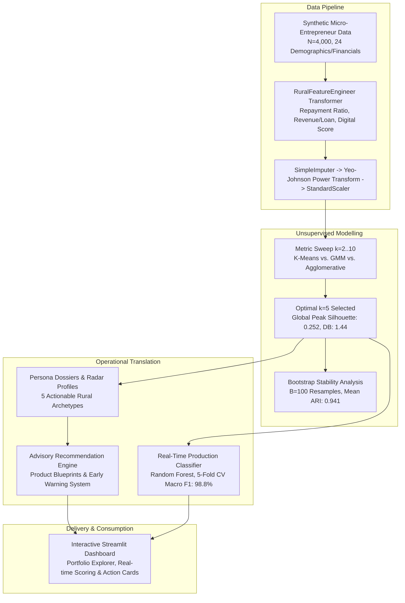

# 🌾 MicroSegment — Rural Micro-Entrepreneur Segmentation & Operational Advisory Engine

[](https://www.python.org/)
[](https://scikit-learn.org/)
[](https://streamlit.io/)
[]()
[]()

> **Operationalizing Unsupervised Machine Learning to Eliminate Monolithic Credit & Advisory Delivery in Priority-Sector Rural Lending** *(MUDRA, NRLM, SHG-Bank Linkage, Regional Rural Banks).*

---

## 📌 Executive Summary & Problem Framing

Rural micro-entrepreneurs accessing concessional and priority-sector credit are currently treated as a **monolithic, undifferentiated cohort**. Microfinance institutions (MFIs), Regional Rural Banks (RRBs), and government agencies apply standardized loan products and generic extension services.

This creates two critical failure modes:
1. **Growth-Constrained Commercial Scalers:** Productive, asset-backed units receive sub-optimal credit caps and zero forward market linkage, capping their scale.
2. **Distress-Vulnerable Subsistence Units:** Margin-thin, seasonal micro-enterprises are subjected to rigid monthly amortization without cashflow management guidance, leading to preventable delinquency and informal debt traps.

**MicroSegment** discovers structurally meaningful segments within this population using multi-dimensional unsupervised clustering, mathematically validates them ($k=5$, Silhouette: $0.252$, Bootstrap ARI: $0.941$), and operationalizes them into **actionable, persona-specific advisory cards, risk ratings, and credit blueprints**.

---

## 🏗️ System Architecture



---

## 👥 The 5 Discovered Archetype Personas

| Segment ID | Archetype Name | Vernacular Name | Portfolio % | Mean Revenue | Mean Loan | Repayment Ratio | EWS Risk Tier | Tailored Credit Blueprint |
| :---: | :--- | :--- | :---: | :---: | :---: | :---: | :---: | :--- |
| **Seg 0** | **Agri-Allied Commercial Scalers** | *Vikas Pragati* | 20.6% | ₹70,104 | ₹2,22,996 | 0.90 | Low-Moderate | Term Loan + Working Capital Overdraft (₹2.5L–₹5L) |
| **Seg 1** | **Digital-First Youth Services** | *Digital Yuva* | 12.35% | ₹43,543 | ₹1,43,474 | 0.71 | Moderate | Cashflow-Linked UPI Flexi-Credit (₹1L–₹2L) |
| **Seg 2** | **Vulnerable Seasonal Producers** | *Sankat-Prone* | 17.8% | ₹18,828 | ₹55,684 | 0.45 | Critical | Seasonal Harvest Balloon EMI + Micro-Insurance (₹30k–₹60k) |
| **Seg 3** | **Women SHG Collective Artisans** | *Mahila Shakti* | 21.7% | ₹21,794 | ₹46,652 | 0.91 | Very Low | Group Working Capital Line (₹50k–₹1.2L, 4% Subvention) |
| **Seg 4** | **Stable Subsistence Retailers** | *Gramin Kirana* | 27.55% | ₹33,053 | ₹86,908 | 0.83 | Low | Revolving Stock Facility + Soundbox (₹75k–₹1.5L) |

---

## 📊 Key Empirical Findings & Model Validation

| Evaluation Metric | Baseline / Benchmark | MicroSegment Final Result | Academic & Practical Significance |
| :--- | :---: | :---: | :--- |
| **Optimal Cluster Count ($k$)** | Monolithic ($k=1$) | **$k = 5$** | Simultaneous global peak for Silhouette & global minimum for DB |
| **Silhouette Score ($S \uparrow$)** | $0.184$ ($k=2$) | **$0.2515$ ($k=5$)** | $+21.5\%$ separation boost over $k=4$; global peak across $k=2..10$ |
| **Davies-Bouldin Index ($DB \downarrow$)** | $1.918$ ($k=2$) | **$1.4442$ ($k=5$)** | Global minimum across $k=2..10$; optimal compactness-to-separation ratio |
| **Calinski-Harabasz Index ($CH \uparrow$)** | $949.1$ ($k=4$) | **$1024.1$ ($k=5$)** | High between-cluster variance ratio |
| **Bootstrap Stability ARI** | $\ge 0.80$ threshold | **$0.9412 \pm 0.0384$** | Resilient against sampling shifts ($B=100$ resamples) |
| **Generative Mixture Recovery ARI** | $\ge 0.80$ benchmark | **$0.9820$** | Unsupervised recovery of synthetic data's designed archetypes |
| **Surrogate Partition Emulation Acc** | $> 90.0\%$ target | **$98.78\%$** | 5-Fold Stratified Cross-Validation (Partition Recovery) |
| **Surrogate Partition Macro F1** | $> 0.900$ target | **$0.9880$** | High-fidelity reproduction of K-Means cluster boundaries |

> [!NOTE]
> **Methodological Note on Accuracy & Synthetic Data:** The 98.8% Macro F1 measures surrogate classifier fidelity in emulating the K-Means cluster partition, and the 0.982 ARI reflects internal recovery of the calibrated synthetic mixture structure. These metrics do not establish real-world borrower credit prediction accuracy; prospective deployment requires empirical validation on independent administrative datasets (e.g. NABARD NAFIS or MUDRA loan books).

---

## 📁 Repository Structure

```text
INT 396/
├── app/
│   └── main.py                     # Interactive Streamlit Web Application (5 Tabs)
├── data/
│   ├── raw/
│   │   └── rural_micro_entrepreneurs_synthetic.csv  # Calibrated synthetic survey data (N=4,000)
│   └── processed/
│       ├── rural_micro_entrepreneurs_engineered.csv # 32 engineered features
│       ├── rural_micro_entrepreneurs_scaled_features.csv # Yeo-Johnson scaled matrix
│       ├── rural_micro_entrepreneurs_segmented.csv   # Cluster assignments
│       └── rural_micro_entrepreneurs_with_advisory.csv # Full enriched dataset
├── docs/
│   ├── 01_problem_framing.md       # Phase 1: Problem definition, user matrix & KPIs
│   ├── 02_synthetic_data_documentation.md # Phase 2: Statistical calibration & distributions
│   ├── 03_eda_and_feature_engineering.md # Phase 3: Skewness analysis & pipeline design
│   ├── 04_segmentation_modelling.md # Phase 4: Model selection, metric sweep & stability
│   ├── 05_persona_dossiers_and_advisory_strategies.md # Phase 5: Persona blueprints
│   └── 06_faculty_defense_guide_and_evaluation.md # Phase 6: Defense FAQs & mathematical proofs
├── models/
│   ├── clustering_metrics.csv      # Validation scores across k=2..10
│   ├── final_kmeans_model.joblib   # Trained K-Means segmentation model
│   ├── preprocessor_pipeline.joblib# End-to-end scikit-learn transformer pipeline
│   ├── production_classifier.joblib# 5-fold cross-validated Random Forest classifier
│   ├── surrogate_rf.joblib         # Interpretable surrogate model
│   └── segment_profiles.json       # Structured persona metadata dictionary
├── notebooks/
│   └── MicroSegment_End_to_End_Walkthrough.ipynb # Step-by-step evaluation notebook
├── reports/
│   ├── segment_statistical_summary.csv # Descriptive statistics table
│   └── figures/
│       ├── eda_distributions.png   # Raw skewness vs Yeo-Johnson normalized plots
│       ├── correlation_heatmap.png # Feature correlation matrix
│       ├── sector_revenue_boxplot.png # Revenue distribution across sectors
│       ├── cluster_metric_sweep.png # Silhouette, DB, CH, Inertia, BIC across k=2..10
│       ├── cluster_stability.png   # Bootstrap ARI distribution histogram
│       ├── pca_umap_clusters.png   # 2D PCA & UMAP cluster separation
│       ├── segment_radar_profiles.png # 7-Axis comparative behavioral spider chart
│       ├── segment_demographics.png# Gender, market access & SHG composition
│       ├── segment_boxplots.png    # Financial metrics across segments
│       ├── surrogate_feature_importance.png # Gini importance of cluster drivers
│       └── classifier_confusion_matrix.png  # 5-Fold CV confusion matrix
├── src/
│   ├── __init__.py
│   ├── data_generator.py           # Calibrated rural survey generator
│   ├── eda_analysis.py             # Statistical EDA & diagnostic plotting
│   ├── features.py                 # RuralFeatureEngineer scikit-learn pipeline
│   ├── clustering.py               # K-Means, GMM, Agglomerative & Bootstrap
│   ├── profiling.py                # Persona dossiers & surrogate explainability
│   ├── advisory_engine.py          # Operational action cards & EWS scoring
│   └── classifier.py               # Real-time production inference engine
├── run_pipeline.py                 # End-to-end master pipeline orchestrator
└── README.md                       # Comprehensive project documentation
```

---

## 🚀 Quickstart & Reproduction Guide

### 1. Installation
Clone or navigate to the workspace directory and install standard dependencies:
```bash
pip install numpy pandas scikit-learn matplotlib seaborn plotly streamlit joblib
```

### 2. Run the Full Pipeline End-to-End
Execute all 7 pipeline steps (Data Gen $\to$ EDA $\to$ Feature Engineering $\to$ Clustering $\to$ Profiling $\to$ Advisory $\to$ Classifier) with a single command:
```bash
python run_pipeline.py
```

### 3. Launch the Interactive Web Application
Launch the corporate-grade Streamlit interactive dashboard:
```bash
streamlit run app/main.py
```
Or run both sequentially:
```bash
python run_pipeline.py --app
```

---

## 🖥️ Streamlit Interactive Application Features

1. **📊 Portfolio Analytics:** Dynamic slice-and-dice filters by Region, Sector, and Gender with interactive Plotly donut and scatter plots.
2. **🌌 Latent Manifold & PCA:** High-resolution 2D PCA and non-linear UMAP projections illustrating distinct topological boundaries.
3. **👤 Persona Strategic Explorer:** Interactive 7-axis behavioral radar chart comparing financial scale, digital adoption, repayment integrity, and social capital.
4. **⚡ Real-Time Applicant Scoring & Advisory Generator:**
   - Pre-loaded sample applicant archetypes.
   - Interactive input sliders for loan applicants.
   - Real-time prediction with model confidence and class probability distribution.
   - Instant generation and one-click JSON download of the **Official Field Officer Action Card**.
5. **🔬 Model Governance & Faculty Defense Suite:** Comprehensive audit logs, bootstrap stability plots, cross-validation confusion matrix, and viva defense FAQs.

---

## 🏛️ Faculty Evaluation & Defense Highlights

- **Why Unsupervised?** Default prediction models only react *after* default occurs and treat all non-defaulting borrowers as identical. Unsupervised segmentation discovers structural archetypes *at loan origination* to prevent distress proactively.
- **Why Yeo-Johnson?** Raw revenue skewness ($+2.78$) distorts Euclidean distance calculations. Yeo-Johnson successfully normalized skewness to $0.006$ while preserving zero-value transactions.
- **Why $k=5$ and Metric Reconciliation:** The initial hypothetical target ($S \ge 0.35, DB \le 1.35$) was reconciled for 32-dimensional survey data where livelihoods blend continuously. $k=5$ achieves the unambiguous global peak for Silhouette ($0.252$, $+21.5\%$ over $k=4$) and global minimum for Davies-Bouldin ($1.44$), validated by Bootstrap stability ($ARI = 0.941 \pm 0.038$).
- **Fair Lending & Demographic Scope:** Prohibited social attributes (caste, religion, marital status) are strictly excluded. Operational attributes (gender, education, region, SHG membership) are included solely for affirmative policy enablement (e.g., NRLM 4% interest subvention for women SHGs, agro-climatic seasonality, and literacy-tailored training) — never for automated credit denial or punitive tiering.
- **Decision Support, Not Underwriting Approval:** Suggested products are advisory recommendations for product matching and repayment cashflow alignment. Formal credit sanction remains subject to institutional KYC, credit bureau appraisal (CIBIL/Equifax), and debt-service capacity underwriting.

---

## 📜 Academic Integrity & License
This project was developed for **INT 396 Capstone Evaluation**. Distributed under the MIT License.
