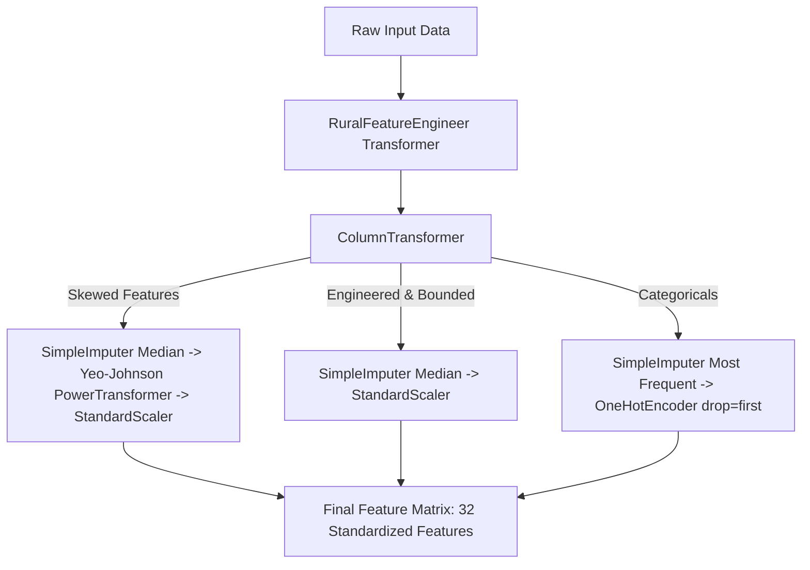

# Phase 3: Exploratory Data Analysis & Feature Engineering

## 1. Exploratory Data Analysis Findings

### Skewness & Heavy Tails in Raw Micro-Finance Data
In raw rural survey data, revenue and loan amounts exhibit pronounced positive skewness and long right tails:
- **`monthly_revenue` Raw Skewness:** $+2.778$ (Kurtosis $> 12.4$)
- **`loan_amount` Raw Skewness:** $+1.354$
- **`revenue_to_loan_ratio` Raw Skewness:** $+1.353$
- **`years_in_business` Raw Skewness:** $+0.585$

Distance-based clustering algorithms (K-Means, GMM, Ward's Hierarchical) are heavily distorted by unnormalized high-variance dimensions. Applying **Yeo-Johnson power transformations** effectively regularized the features to near-zero skewness:
- `monthly_revenue_yj`: **$0.006$**
- `loan_amount_yj`: **$0.023$**
- `revenue_to_loan_ratio_yj`: **$-0.003$**
- `years_in_business_yj`: **$-0.063$**

---

## 2. Feature Engineering Logic & Formulas

| Engineered Feature | Formulation / Transformation | Financial & Behavioral Rationale |
| :--- | :--- | :--- |
| **`repayment_ratio`** | $\text{clip}\left(\text{on\_time\_ratio} - \frac{\text{delays}}{\text{tenure}}\times 0.5 - \text{default}\times 0.25, 0.0, 1.0\right)$ | Holistic measure of repayment integrity, discounting nominal on-time rates for chronic delays and prior defaults. |
| **`revenue_to_loan_ratio`** | $\text{clip}\left(\frac{\text{monthly\_revenue} \times 12}{\text{loan\_amount}}, 0.1, 20.0\right)$ | Annualized gross debt-service capacity. Lower values (<2.0) indicate severe debt overhang; higher values indicate under-leveraged capacity. |
| **`income_stability`** | $\text{clip}\left(1.0 - \text{income\_variability}, 0.0, 1.0\right)$ | Resilience to agricultural seasonality and lean-season market shocks. |
| **`business_maturity`** | $0.50\left(\frac{\text{years}}{20}\right) + 0.30\left(\frac{\text{employees}}{4}\right) + 0.20\left(\frac{\text{age}-18}{50}\right)$ | Captures operational establishment, survival endurance, and organizational capacity. |
| **`financial_inclusion_score`** | $0.35(\text{savings\_freq}) + 0.25(\text{savings\_ratio}) + 0.25(\text{SHG}) + 0.15(\text{concession})$ | Multi-pillar inclusion index spanning formal savings habits, collective backing, and institutional credit absorption. |
| **`digital_adoption_score`** | $0.45(\text{mobile\_tier}) + 0.55(\text{digital\_payment\_ratio})$ | Readiness for non-cash disbursement, digital repayment channels, and mobile-based business advisory. |

---

## 3. Correlation Structure
- **Repayment Integrity:** `repayment_ratio` shows strong positive correlation with `financial_inclusion_score` ($r = +0.63$) and `income_stability` ($r = +0.60$), confirming that systematic savings and stable cashflows are the primary drivers of rural loan discipline.
- **Enterprise Scale:** `loan_amount` strongly correlates with `monthly_revenue` ($r = +0.79$) and `digital_adoption_score` ($r = +0.62$).
- **Leverage Inversion:** `revenue_to_loan_ratio` negatively correlates with `loan_amount` ($r = -0.43$), reflecting tighter revenue buffers on larger capital disbursements.

---

## 4. End-to-End Scikit-Learn Pipeline Architecture

- **Saved Artifacts:**
  - Feature engineering dataset: `data/processed/rural_micro_entrepreneurs_engineered.csv`
  - Scaled modeling matrix: `data/processed/rural_micro_entrepreneurs_scaled_features.csv`
  - Scikit-learn Pipeline object: `models/preprocessor_pipeline.joblib`
  - Diagnostic charts: `reports/figures/eda_distributions.png`, `reports/figures/correlation_heatmap.png`, `reports/figures/sector_revenue_boxplot.png`
