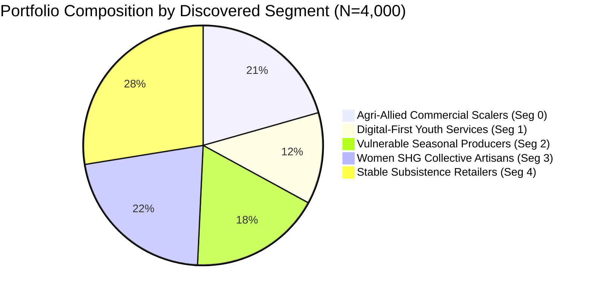

# Phase 5: Persona Dossiers & Operational Advisory Strategies

## 1. Synthesis of Discovered Segments

Through unsupervised multi-criteria clustering ($k=5$) regularized via Yeo-Johnson transformations and validated with bootstrap stability ($ARI = 0.941$), the rural micro-entrepreneur cohort partitions into five distinct structural archetypes:

---

## 2. In-Depth Persona Dossiers

---

### Segment 0: Agri-Allied Commercial Scalers (*"Vikas Pragati"*)
- **Portfolio Share:** $20.6\%$ ($n = 824$)
- **Representative Sectors:** Dairy farming, horticulture nurseries, food processing, agri-logistics.
- **Risk Tier:** Low to Moderate | **Digital Tier:** Intermediate

| Metric | Segment Mean | Portfolio Baseline | Variance |
| :--- | :---: | :---: | :---: |
| **Monthly Revenue** | ₹70,104 | ₹36,920 | $+89.9\%$ |
| **Average Loan Amount** | ₹222,996 | ₹108,450 | $+105.6\%$ |
| **Repayment Integrity Ratio** | $0.90$ | $0.78$ | $+15.4\%$ |
| **Income Stability** | $0.76$ | $0.65$ | $+16.9\%$ |
| **Digital Adoption Score** | $0.75$ | $0.53$ | $+41.5\%$ |
| **Business Longevity** | $8.46$ yrs | $6.42$ yrs | $+31.8\%$ |
| **Employees Hired** | $2.10$ | $0.82$ | $+156.1\%$ |

#### Structural Profile & Behavioral DNA
These are the growth engines of the rural economy. They possess established physical assets (milking machinery, polyhouses, sorting sheds) and multi-year track records. Their higher loan amounts are backed by robust debt-service coverage, but their primary ceiling is working capital lockup in seasonal inventory and delayed receivables from mandi buyers.

#### Tailored Advisory & Credit Blueprints
1. **Lending Product:** Transition from standard microcredit to **Asset-Backed Term Loans & Working Capital Overdraft Limits** (₹2.5L – ₹5.0L) with quarterly turnover-linked reviews.
2. **Field Touchpoints:** Monthly relationship manager visits; quarterly balance-sheet and inventory audits.
3. **Capacity Building:** Cold chain logistics, direct B2B institutional buyer contracts (e-NAM, corporate off-takers), and formal GST/FSSAI compliance.
4. **Delinquency Triggers:** Feed price inflation spikes, localized disease outbreaks, or receivables delays $> 45$ days from commercial buyers.

---

### Segment 1: Digital-First Youth Services (*"Digital Yuva"*)
- **Portfolio Share:** $12.35\%$ ($n = 494$)
- **Representative Sectors:** Mobile/electronics repair, Common Service Centers (CSC), digital photography/printing, rural logistics hubs.
- **Risk Tier:** Moderate (High growth, limited credit history) | **Digital Tier:** Advanced

| Metric | Segment Mean | Portfolio Baseline | Variance |
| :--- | :---: | :---: | :---: |
| **Monthly Revenue** | ₹43,543 | ₹36,920 | $+17.9\%$ |
| **Average Loan Amount** | ₹143,474 | ₹108,450 | $+32.3\%$ |
| **Repayment Integrity Ratio** | $0.71$ | $0.78$ | $-9.0\%$ |
| **Income Stability** | $0.55$ | $0.65$ | $-15.4\%$ |
| **Digital Adoption Score** | $0.85$ | $0.53$ | $+60.4\%$ |
| **Business Longevity** | $2.32$ yrs | $6.42$ yrs | $-63.9\%$ |
| **Employees Hired** | $0.72$ | $0.82$ | $-12.2\%$ |

#### Structural Profile & Behavioral DNA
Young, ambitious, smartphone-native entrepreneurs with high digital fluency (digital payment ratio $> 60\%$). While revenue velocity is rapid, their operational tenure is brief ($< 3$ years), creating cashflow volatility and occasional payment delays due to aggressive reinvestment rather than business failure.

#### Tailored Advisory & Credit Blueprints
1. **Lending Product:** **Dynamic Digital-Underwritten Flexi-Credit** with UPI transaction-based cashflow sweeps and weekly micro-repayments.
2. **Field Touchpoints:** Bi-weekly app-based nudges and WhatsApp conversational banking; quarterly in-person field check-ins.
3. **Capacity Building:** Inventory optimization software, ONDC merchant onboarding, digital marketing, and formal bookkeeping.
4. **Delinquency Triggers:** Sharp drops in daily UPI transaction count, inventory obsolescence, or rapid device repair warranty claims.

---

### Segment 2: Vulnerable Seasonal Producers (*"Sankat-Prone"*)
- **Portfolio Share:** $17.8\%$ ($n = 712$)
- **Representative Sectors:** Marginal rainfed crop cultivation, seasonal horticulture, roadside hawking.
- **Risk Tier:** High / Critical Delinquency Risk | **Digital Tier:** Basic / Nascent

| Metric | Segment Mean | Portfolio Baseline | Variance |
| :--- | :---: | :---: | :---: |
| **Monthly Revenue** | ₹18,828 | ₹36,920 | $-49.0\%$ |
| **Average Loan Amount** | ₹55,684 | ₹108,450 | $-48.7\%$ |
| **Repayment Integrity Ratio** | $0.45$ | $0.78$ | $-42.3\%$ |
| **Income Stability** | $0.37$ | $0.65$ | $-43.1\%$ |
| **Digital Adoption Score** | $0.27$ | $0.53$ | $-49.1\%$ |
| **Delayed Installments** | $2.60$ | $0.96$ | $+170.8\%$ |

#### Structural Profile & Behavioral DNA
This segment represents the primary source of credit stress. Income is acutely tied to monsoon vagaries and harvesting windows. Rigid monthly EMI amortization forces them into distress borrowing from informal moneylenders to service institutional debt.

#### Tailored Advisory & Credit Blueprints
1. **Lending Product:** **Seasonal Bullet-Repayment Loans** (moratorium during sowing/growing; repayment concentrated post-harvest) bundled with parametric weather/crop micro-insurance.
2. **Field Touchpoints:** Weekly field officer visits during lean pre-harvest months; SMS voice alerts on weather patterns.
3. **Capacity Building:** Climate-resilient agricultural practices, secondary non-farm income diversification (beekeeping, mushroom cultivation), and emergency contingency savings.
4. **Delinquency Triggers:** Rainfall deficits $> 20\%$, pest infestation alerts, sudden dips in village mandi wholesale prices.

---

### Segment 3: Women SHG Collective Artisans (*"Mahila Shakti"*)
- **Portfolio Share:** $21.7\%$ ($n = 868$)
- **Representative Sectors:** Handloom weaving, embroidery, zardozi, bamboo crafts, organic spices, papad/pickle collectives.
- **Risk Tier:** Very Low (Pristine Credit Discipline) | **Digital Tier:** Emerging

| Metric | Segment Mean | Portfolio Baseline | Variance |
| :--- | :---: | :---: | :---: |
| **Monthly Revenue** | ₹21,794 | ₹36,920 | $-41.0\%$ |
| **Average Loan Amount** | ₹46,652 | ₹108,450 | $-57.0\%$ |
| **Repayment Integrity Ratio** | $0.91$ | $0.78$ | $+16.7\%$ |
| **Income Stability** | $0.66$ | $0.65$ | $+1.5\%$ |
| **Financial Inclusion Score** | $0.76$ | $0.55$ | $+38.2\%$ |
| **SHG Affiliation** | $100\%$ | $52.4\%$ | $+90.8\%$ |
| **Gender (Female)** | $100\%$ | $44.1\%$ | $+126.8\%$ |

#### Structural Profile & Behavioral DNA
The backbone of social capital. Highly cohesive peer-monitoring groups with nearly flawless on-time repayment records ($0.91$). However, they suffer from severe credit rationing (average loans under ₹50k) and intermediary exploitation, selling finished goods to middlemen at $25-30\%$ of final consumer market value.

#### Tailored Advisory & Credit Blueprints
1. **Lending Product:** **Collective Artisan Credit Lines & Equipment Micro-Leases** (₹75k – ₹1.2L per group member) with lower interest rates (4-5% concessional subvention).
2. **Field Touchpoints:** Monthly participation in SHG cluster meetings; quarterly artisan federation workshops.
3. **Capacity Building:** Collective raw material bulk purchasing, digital cataloging, design contemporization, and SARAS / TRIFED market exhibitions.
4. **Delinquency Triggers:** Disbandment or internal conflicts in the self-help group, sudden medical shocks in the household.

---

### Segment 4: Stable Subsistence Retailers (*"Gramin Kirana"*)
- **Portfolio Share:** $27.55\%$ ($n = 1,102$)
- **Representative Sectors:** Village grocery stores, general provisions, tea stalls, hardware retail.
- **Risk Tier:** Low (Mature Cash Cow) | **Digital Tier:** Intermediate

| Metric | Segment Mean | Portfolio Baseline | Variance |
| :--- | :---: | :---: | :---: |
| **Monthly Revenue** | ₹33,053 | ₹36,920 | $-10.5\%$ |
| **Average Loan Amount** | ₹86,908 | ₹108,450 | $-19.9\%$ |
| **Repayment Integrity Ratio** | $0.83$ | $0.78$ | $+6.4\%$ |
| **Income Stability** | $0.81$ | $0.65$ | $+24.6\%$ |
| **Business Longevity** | $10.21$ yrs | $6.42$ yrs | $+59.0\%$ |
| **Digital Adoption Score** | $0.47$ | $0.53$ | $-11.3\%$ |

#### Structural Profile & Behavioral DNA
Highly entrenched cornerstones of the rural retail ecosystem. With average operational tenure exceeding a decade, they boast the highest cashflow stability ($0.81$). Their credit needs are steady, driven by wholesale inventory replenishment. They are conservative and risk-averse, relying on informal supplier credit.

#### Tailored Advisory & Credit Blueprints
1. **Lending Product:** **Revolving Supplier Credit Facility & Fast-Track Working Capital Top-Ups** (₹1.0L – ₹1.5L) with automated renewal upon prompt repayment.
2. **Field Touchpoints:** Bi-monthly merchant visits; digital soundbox audio transaction verification.
3. **Capacity Building:** UPI Soundbox adoption, supplier credit digitization, FMCG fast-moving inventory management, and store layout optimization.
4. **Delinquency Triggers:** Emergence of a new competing supermarket/retailer nearby, prolonged local drought curbing village purchasing power.

---

## 3. Comparative Strategic Matrix Across Roles

| Dimension | Seg 0: Commercial Scalers | Seg 1: Youth Services | Seg 2: Vulnerable Seasonal | Seg 3: SHG Artisans | Seg 4: Subsistence Retail |
| :--- | :--- | :--- | :--- | :--- | :--- |
| **Primary Credit Product** | Term Loan + Overdraft | Daily/Weekly Flexi-Credit | Seasonal Balloon EMI | Group Working Capital | Revolving Trade Facility |
| **Ticket Size Range** | ₹2.5L – ₹5.0L | ₹1.0L – ₹2.0L | ₹30k – ₹60k | ₹50k – ₹1.2L | ₹75k – ₹1.5L |
| **Field Officer Visit Cadence** | Monthly | Bi-weekly (Digital) | Weekly (High Touch) | Monthly (Group Meeting) | Bi-monthly |
| **Advisory Priority** | Capex & Forward Contracts | Inventory App & ONDC | Climate Resilience & Insurance| Aggregation & Exhibitions| Wholesale Margins & UPI |
| **Early Warning Risk Flag** | Receivable Delays $>45$d | Sudden Dips in UPI Velocity | Rainfall Deficit / Crop Shock | Peer Group Discord | Margin Squeeze from Competitor |
| **Expected 12M PAR-30 Impact**| $-10\%$ | $-15\%$ | **$-35\%$** | $-5\%$ | $-12\%$ |
